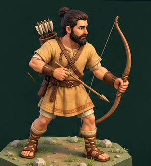

# Лучник — целевое качество персонажей локального художника

11 октября 2026 года · версия 1.0. Заказчик предоставил референс и указал: «вам такого лучника нужно будет делать локально». Это целевой уровень будущей настоящей модели, а не отчёт о готовом автоматическом результате.

Связанные материалы: [общий OpenSpec художника](../openspec-model-artist-ru.md), [состав E03](../../era-03-bronze-content-ru.md), [реальные границы локальной программы](../visual-direction-discussion-ru.md), [первые отдельные модели](../StarterModels/README.md).

## 1. Назначение и границы

Основной чат задаёт концепт по сценарию заказчика. Чат художника разрабатывает локальную программу и отвечает за настоящие модели, материалы, скелеты, веса, собственные анимации и адаптацию пользовательских клипов. Игровая интеграция выполняется отдельно. Референс сохраняется как ориентир формы и качества; изображение не является мешем, ригом или анимационным клипом.

Лучник относится к последующему развитию вооружения. Первый ранний дальнобойный юнит по действующим требованиям — пращник. Выбор этого референса не меняет эпохи, исследовательские условия, стоимость и порядок появления войск.

Первоначальная очередь горшок → бревно → ограда → соломенная панель → корзина проверяет одиночные формы и материалы локального процесса. Лучник задаёт отдельную более сложную цель персонажей; работа по одному оцениваемому образцу сохраняется.

## 2. Художественный образ

- Сильный, естественный и немного стилизованный человек с выразительным лицом, читаемыми бровями, носом, глазами и бородой.
- Тёмные волосы собраны в пучок, пряди создают объёмную форму; волосы и борода имеют крупные группы, затем мелкие детали.
- Светлая охристая туника с подвёрнутыми рукавами, заметными складками и простым орнаментом по нижнему краю.
- Кожаный пояс, ремни, сумка/чехол, защита предплечий и обмотки ног. Открытая обувь с понятными ремнями.
- Длинный деревянный лук, тонкая тетива, отдельная стрела и колчан с читаемым оперением.
- Тёплые натуральные оттенки, мягкие переходы и различимые поверхности кожи человека, ткани, дерева и кожи снаряжения.

Главное с расстояния карты — силуэт стрелка, лук, положение рук и цвет одежды. При приближении видны лицо, волосы, руки, складки и детали оружия. Маленькие элементы не превращают персонажа в мерцающий шум.

Фигура моделируется целиком, включая боковую и заднюю стороны. Единственный вид не определяет их точно; художник готовит согласованные ракурсы и отмечает интерпретированные детали. Гекс, растения, камни, свет и фон референса — только окружение просмотра, их в персонажа не включать.

## 3. Конструкция и риг

Персонаж — деформируемая модель с настоящим скелетом и весами. Нужны рабочие плечи, локти, запястья, ладони/пальцы, таз, колени, стопы, шея и голова. Одежда следует движению тела, удерживает объём складок и не прорезается на основных позах.

Общая база человека переиспользуется для других профессий и войск, сохраняя единый художественный масштаб. Humanoid-совместимость — цель экспорта для Unity, подтверждается проверкой; существующий Generic-риг сам по себе не доказывает её.

Лук, тетива, стрелы и колчан — отдельные управляемые части. Предусмотреть точки хвата лука, контакта тетивы/стрелы с пальцами и крепления колчана. Лук удерживается одной рукой, другая согласованно натягивает тетиву; плечи лука реагируют на натяжение. Способ деформации оружия описать в передаче. Нейтральная техническая поза и bind pose сохраняются независимо от красивой демонстрационной позы.

Размер человека сверяется с принятой базой персонажей. Единицы — метры, в Blender Z вверх, после экспорта Unity Y вверх и +Z вперёд, масштаб корня 1, основание на земле. Оси оружия и точки хвата описаны отдельно.

## 4. Движения, после оценки статической модели

Предлагаемый набор: ожидание, ходьба, подготовка стрелы/натяжение, удержание прицела, выпуск/восстановление, получение удара, падение. Пользовательские клипы сохраняются отдельно, при адаптации отмечаются изменения. Для специфической стрельбы художник создаёт свои движения.

Во время натяжения ладони, стрела и тетива согласованы, руки не проходят через корпус/оружие. Ходьба сохраняет контакт стоп с землёй, колчан и лук закреплены. Движение не разваливается при осмотре сбоку и сзади. Момент создания игрового снаряда, попадания и урона определяет логика игры; визуальная анимация воспроизводит принятое действие.

## 5. Проверка и передача

1. Сначала полноценная статическая форма: общий вид, крупное лицо/руки, бок/спина, игровая изометрия, оборот при постоянном свете.
2. После оценки — риг и веса: техническая поза, сгибы суставов, хват, движения оружия.
3. Затем движения с проверкой контактов и отдельные LOD, сохраняющие силуэт и посадку снаряжения.
4. Передача исходника BLEND, FBX, текстур, отдельных клипов, рендеров и README с костями, bind pose, точками хвата, координатами, размерами и результатами проверок.

Подробный вариант сохраняется для близкого просмотра; облегчённые версии проверяются на игровой камере. Полигонный бюджет выбирается после оценки формы и повторения на карте. Один красивый рендер не подтверждает деформации скелета или готовность клипов.

## 6. Что предстоит локальному инструменту

По отчёту художника текущий автоматический путь строит модели из ограниченных конструкторов Blender по JSON. Хорошие прежние копейщик, дом и камень являлись авторскими сборками. Качество лица, пальцев, причёски, деформируемой одежды, корректных весов и стрельбы новой автоматически созданной модели ещё требуется отдельно подтвердить.

У художника есть авторская база копейщика в `build_spearman.py`: человек, 60 костей, пальцы, веса, одежда и экспорт клипов. Она привязана к копейщику и пока не является общим автоматическим процессом «изображение → персонаж». Количество костей не подтверждает Humanoid-совместимость; её проверяют при интеграции в Unity.

Предложенный художником путь развития локальной программы:

1. Структурированное описание персонажа через локальный Qwen: пропорции, лицо, волосы, одежда, снаряжение и палитра.
2. Параметрическая человеческая база с топологией суставов и отдельными модулями волос, одежды и снаряжения.
3. Материалы кожи человека, волос, ткани, кожи снаряжения и дерева, UV и запекание; оценка настоящей неподвижной модели.
4. Общий скелет и веса с проверкой сгибов после принятия статической формы.
5. Управляемые лук, плечи лука и тетива, точки хвата, контакты стрелы и пальцев.
6. Движения стрельбы, проверка синхронизации рук/оружия и обратного импорта FBX.

Спину, техническую позу, размеры и траектории стрельбы нужно задать и оценить отдельно: единственная картинка их не определяет.

Этот документ задаёт критерии развития процесса и оценки результата. Его нельзя использовать как заявление, что нынешняя программа уже автоматически создаёт такого лучника. Конкретный способ создания формы, рига, материалов и клипов предлагает художник с проверкой одной модели. Основной чат не меняет код локальной программы этим заданием.
