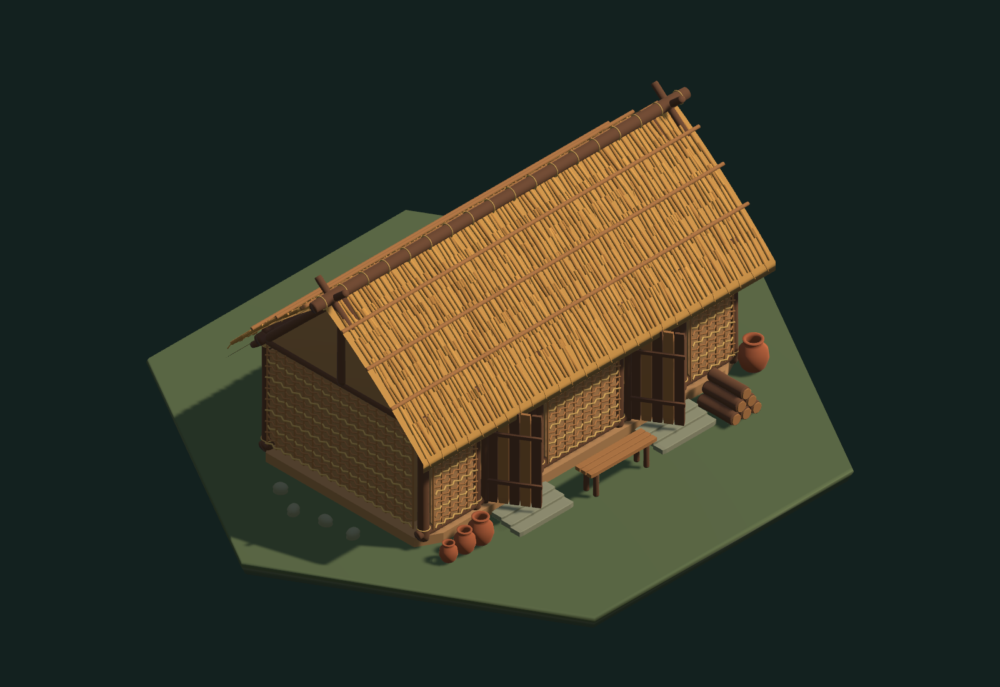

# Длинный дом — первый образец архитектуры E02

11 октября 2026 года. Первая новая постройка из [проекта контента неолита](../../era-02-neolithic-content-ru.md), созданная по [листу построек](e02-buildings-v1.png). Остальные новые здания пока не моделируются: сначала оцениваем этот образец.

Prefab: `Assets/Resources/Buildings/Longhouse.prefab`. Материалы и meshes: `Assets/Art/Buildings/Longhouse`. Сцена: `Assets/Scenes/LonghouseShowcase.unity`. Меню Unity: **Истоки → Разработка → Открыть длинный дом**, затем Play. Готовый просмотр: `Builds/LonghousePreview/LonghousePreview.exe`. Дом также добавлен последним образцом вкладки «Постройки» общей галереи разработки.

Модель содержит деревянные опоры, пороги и перекладины, верёвочные крепления, глиняное заполнение с плетением из прутьев, два настоящих дверных проёма с открытыми дощатыми дверями, толстую изогнутую крышу с семью рядами соломенных пучков на каждом скате и деревянный конёк. У входов — каменные ступени, скамья, полые сосуды и запас дров. Под крышей — шесть настилов с циновками, общий стол, каменное кольцо очага и сосуды. Металла, стеклянных окон и поздней каменной кладки нет.

Крыша, каркас со стенами, интерьер и двор сохранены отдельными частями. Клавиша **R** снимает/возвращает крышу; **Home** возвращает исходный вид. Ползунок вращает дом, колесо меняет масштаб. Камера остаётся ортографической с наклоном 35,264° и азимутом 45°. [Вид сзади](Longhouse/rear.png), [без крыши](Longhouse/interior.png), [крупный план](Longhouse/detail.png).

Сборка проверена запуском Unity-плеера: четыре вида сняты через Camera.Render в RenderTexture. Число треугольников и отрисовок сохранено в [статистике захвата](Longhouse/stats.json); журналы находятся в `TestResults/Longhouse`. Для повторного захвата: `-longhouse-capture <папка>`. Меню **Собрать длинный дом** воспроизводит prefab и сцены; **Собрать просмотр длинного дома** также собирает отдельный просмотр и общую галерею Windows. Пересборка общей галереи сохраняет образец дома.

`WorldView` подготовлен для визуального ID `longhouse`: дом помещается на одну клетку в масштабе 0,22. Производство, исследования и бонусы не подключены этим изменением. В проекте E02 его условия — родовые связи и деревообработка, цена 24 труда или модернизация хижин за 12, эффект +2 вместимости и +1 счастья; это по-прежнему проект правил, а не уже действующая экономика. OpenSpec не изменён.

Упрощения первого образца: двери и реквизит статичны, огонь и жители не анимированы; крыша снимается только для просмотра. Это подробный образец для оценки графики, пока без LOD. Перед массовым использованием в браузерной игре нужна версия с меньшим количеством геометрии на дальних расстояниях. Часть тонких прутьев уже использует более простой профиль без изменения количества видимых деталей.
