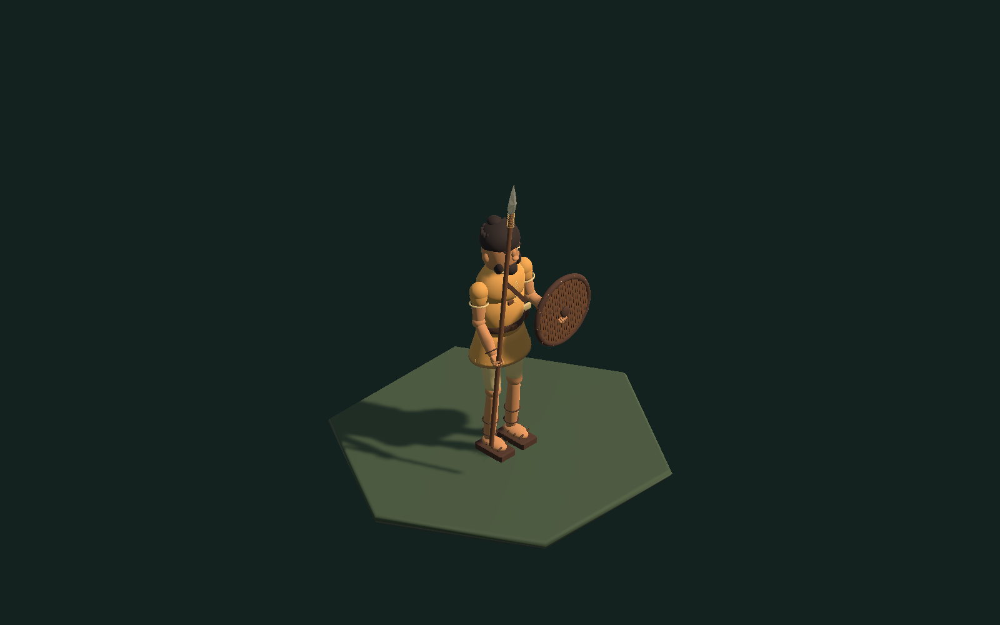

# Копейщик: первая игровая 3D-модель

11 октября 2026 года. Визуальный образец E02 по листу [юнитов](e02-units-v1.png) и [проекту контента неолита](../../era-02-neolithic-content-ru.md). OpenSpec не изменён. Копейщик ещё не добавлен в производство: для этого отдельно нужны исследования E02 и правила боя.

Модель сохранена как Unity prefab: `Assets/Resources/Units/Spearman.prefab`. Геометрия, материалы, Animator Controller и шесть клипов находятся в `Assets/Art/Units/Spearman`. Это настоящая геометрия, а не рисунок или плоскость с текстурой. 62 330 треугольников, 46 MeshRenderer, 21 сустав/точка крепления. Охристая туника, швы, перевязь, пояс с сумкой, волосы и борода, пальцы, сандалии; деревянное копьё с обмотками и кремнёвым остриём, щит из семи досок с кожаным ободом. Металлических частей нет. Цвет туники можно менять для племени через MaterialPropertyBlock.

## Просмотр

Открыть `Assets/Scenes/SpearmanShowcase.unity` и нажать Play. Меню Unity: **Истоки → Разработка → Открыть копейщика**. Камера ортографическая, наклон 35,264°, азимут 45°. Ползунок поворачивает саму модель, колесо меняет масштаб. Клавиши 1–6 выбирают движение, Пробел ставит анимацию на паузу; есть повтор, темп 0,3–1,5× и последовательный просмотр.

Готовый локальный просмотр: `Builds/SpearmanPreview/SpearmanPreview.exe`. В общей сцене `DevelopmentGallery.unity` копейщик добавлен последним образцом вкладки «Юниты»; там автоматически проигрываются все шесть движений. Её сборка: `Builds/DevelopmentGallery/DevelopmentGallery.exe`.

## Как анимируется

Generic-иерархия: таз → позвоночник → грудь → шея → голова; от таза — бедро, колено и стопа, от груди — плечо, локоть и кисть. Копьё прикреплено к `RightShoulder/Elbow/Hand/SpearGrip`, щит — к `LeftShoulder/Elbow/Hand/ShieldGrip`. Каждая жёсткая деталь следует своему суставу. Геометрия объединена только внутри одного сустава и материала; суставы и крепления оружия остаются независимыми.

| Клип | Длительность | Действие |
| --- | --- | --- |
| Idle | 1,6 с, цикл | Дыхание и небольшие движения рук |
| Walk | 0,9 с, цикл | Перенос ног, сгибание коленей, ровная стопа, два шага |
| Thrust | 1,1 с | Замах, выпад, возврат; касание на 48% клипа |
| Guard | 1,4 с, цикл | Щит перед телом, устойчивая стойка |
| Hit | 0,55 с | Отклонение корпуса и восстановление |
| Death | 1,3 с | Падение на бок с удержанием последней позы |

Кривые находятся в обычных `.anim` и доступны для редактирования в Animation. Controller использует `Moving` и `Guarding`; ходьба переключается автоматически, выпад и получение удара возвращаются в Idle, Death не имеет выхода. В `SpearmanVisual` есть `SetWalking(bool)` и `PlayAction(SpearmanPose)`. `PreviewPose` предназначен для галереи: он позволяет повторно показать падение и выбрать конкретный момент клипа.

Root motion отключён. Передвижение корневого объекта задаёт карта; небольшие смещения таза остаются внутри модели. Положение стоп вычислено при создании кривых через двухзвенную кинематику: постоянного расчёта IK во время игры нет. `WorldView` уже умеет показывать `UnitKind.Spearman` и переключать ходьбу при движении отряда. Значение добавлено в конец enum, существующие числовые ID сохранены; имя и 2 очка движения соответствуют проекту E02.

События `OnFootstep` и `OnThrustContact` только уведомляют презентацию. На них можно подключить звуки, пыль, вспышку попадания. Они не списывают здоровье, не тратят очки и не меняют ход. В мультиплеере сервер сначала разрешает приказы и рассчитывает бой; клиент затем выбирает клип по результату. Позднее скорость Walk подгоняется под длительность перехода между клетками, а несколько участников отряда могут иметь небольшое смещение фазы.

## Проверка и воспроизводимость

Меню **Истоки → Разработка → Собрать копейщика** создаёт prefab, клипы, сцену и образец галереи. **Проверить копейщика** проверяет 186 моментов клипов: конечные значения суставов, неподвижный корень, ровные стопы над землёй в Idle/Walk и направление наконечника во время выпада. **Собрать просмотр копейщика** выполняет эти проверки, общие проверки правил игры и собирает оба просмотра для Windows.

Сборка запущена на Direct3D 11. Сняты шесть реальных поз Animator: [ходьба](Spearman/walk.png), [выпад](Spearman/thrust.png), [защита](Spearman/guard.png), [удар](Spearman/hit.png), [падение](Spearman/death.png). Проверены переход Idle → Walk → Idle, два события шага, одно событие выпада, возврат в Idle и удержание Death после команды двигаться. Логи и статистика: `TestResults/Spearman`; параметры запуска для проверки — `-spearman-capture <папка>`. Кадры сняты через Camera.Render в RenderTexture; это не снимки интерфейса.

## Упрощения первого образца

Это риг с жёсткими частями, без деформируемой кожи/ткани, Humanoid-ретаргетинга, пальцевых суставов, ragdoll и столкновений оружия. Падение — готовый клип. Перед массовым отображением в браузерной игре нужны LOD и сокращение числа материалов/отрисовок; нынешняя детализация предназначена прежде всего для проверки одного персонажа в галерее. Будущий skinned mesh можно подключить к тому же набору действий, сохранив направление +Z, крепления оружия и контракт игровой логики.
