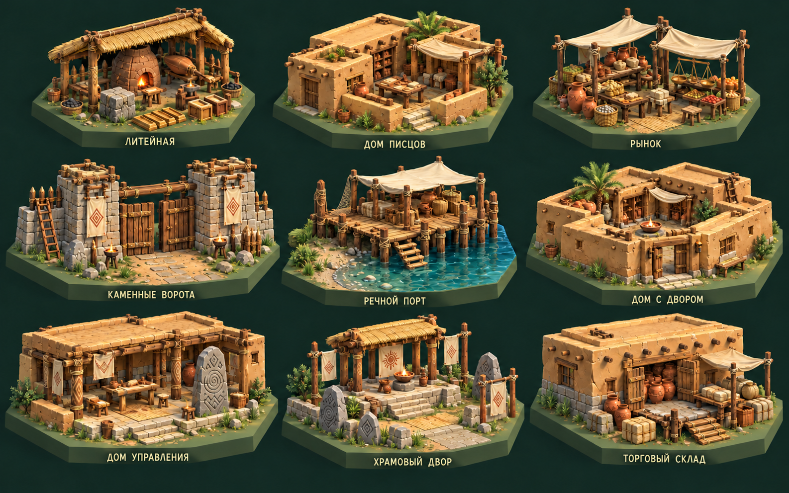
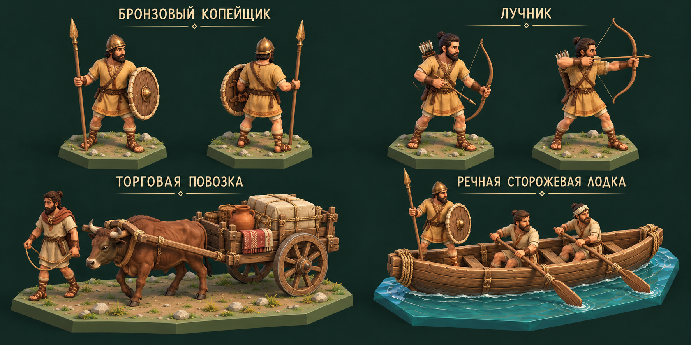
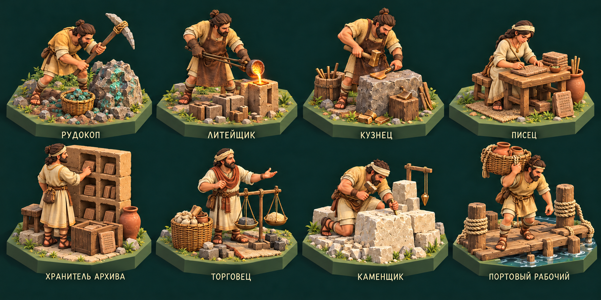
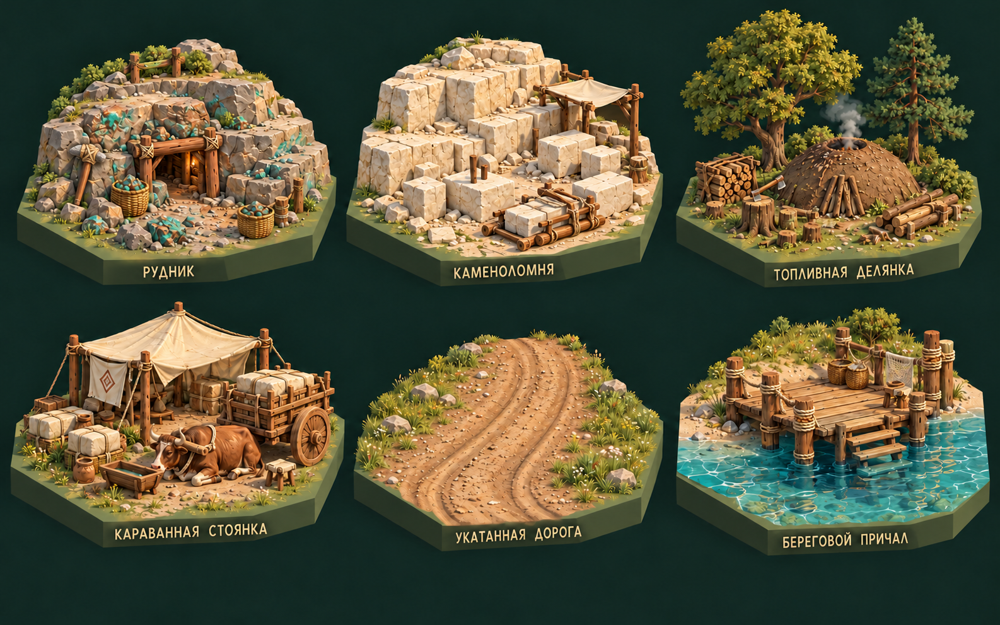
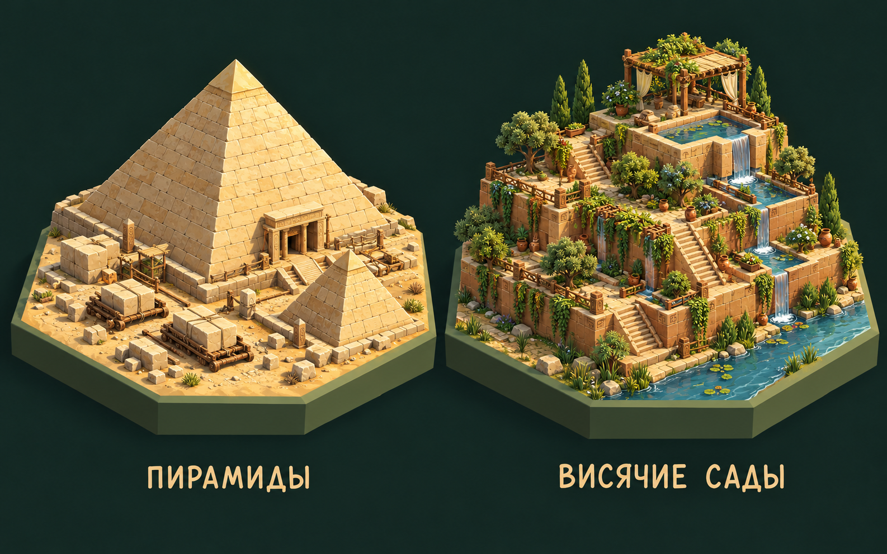

# E03 — задание художнику: бронзовый век и древние города

11 октября 2026 года · версия 1.0 · художественные концепты и требования для будущих 3D-ассетов.

Прочитать [общий OpenSpec художника](../openspec-model-artist-ru.md) и [контент E03](../../era-03-bronze-content-ru.md). Здесь уточняются модели следующей эпохи, а не меняется игровой код. Общая задача художника сохраняется: красивые модели, полноценные скелеты/веса, собственные анимации, исправление клипов заказчика и экспорт для Unity. Импорт, prefabs, Animator и логика — работа основного чата.

Эскизы являются **рисунками-референсами**, не meshes, ригами или готовыми анимационными клипами. Все 29 позиций имеют статус концепта, включая новые художественные варианты уже существующих чудес. Изготовление моделей — по одному образцу с оценкой заказчика.

## 1. Образ и материалы

Сохранить стиль [E02](../E02/README.md): подробные стилизованные объёмные формы, спокойная зелень, дерево, солома, ткань, кожа, верёвка, глина и мягкое тёплое освещение. Новое: сырцовые стены, каменные основания, плоские крыши с балками, бронзовые детали тёплого медово-коричневого цвета, весы, таблички и дощатые лодки. Камень разных форм и размеров; бронза не выглядит хромом или сталью.

Изометрия ортографическая, ориентир камеры 35,264°/45°. Все модели читаются с карты и при приближении. Архитектура ранних городов, без средневековых замков и античных мраморных колоннад. Своды, арки и декоративные колонны не обязательны. Обычные города — собирательный образ; национальные варианты отдельным заданием.

Листы и позиции, сверху слева с единицы:

| Файл | Сетка / объекты |
| --- | --- |
| [Постройки — итоговый v2](e03-buildings-v2.png) | 3×3, девять зданий |
| [Юниты](e03-units-v1.png) | 2×2, четыре отряда/транспортных объекта |
| [Жители](e03-residents-v1.png) | 2×4, восемь профессий |
| [Улучшения — итоговый v2](e03-tiles-v2.png) | 2×3, шесть улучшений/модулей |
| [Чудеса](e03-wonders-v1.png) | Два самостоятельных гекса: Пирамиды слева, Висячие сады справа |

Полные [промпты](prompts.json) — пять исходных запросов и два исправления; [реестр](asset-list.json) содержит ID и позиции. Использован встроенный `image_gen.imagegen`. Подписи помогают найти объект; при моделировании ID и требования данного документа главнее случайных деталей рисунка. Несовпадения перечислить до распространения на другие модели.

Итоговые v2 исправляют наковальню литейной на каменный рабочий блок и кирку рудника на каменное орудие с обмотками. Исходные v1 этих двух листов сохранены для истории; моделировать по v2. Мелкие металлические инструменты E03 окрашивать бронзовыми, а не стальными, независимо от бликов на рисунке.

## 2. Архитектура — формы и части

| ID / позиция | Силуэт и видимые детали | Части и точки |
| --- | --- | --- |
| `bronze_foundry` / 1,1 | Приземистый навес и глиняная печь; отверстие с умеренным жаром, тигель, формы, мехи, рабочий камень, слитки, древесный уголь | Печь, мехи, тигель, формы, инструменты отдельно; `WorkPoint`, `FurnacePoint`, место безопасного прохода |
| `scribal_house` / 1,2 | Сырцовый дом с открытым двором и плоской крышей; стол писца, таблички, ниши/ящики архива | Снимаемая крыша, стол, стеллажи/ниши, таблички; `WorkPoint`, `Entrance`, место сидения |
| `market` / 1,3 | Открытые тканевые тенты на столбах; столы, корзины, керамика, весы и гири | Модуль прилавка, тент, весы, груз; `TradePoint`, место разгрузки повозки |
| `stone_gate` / 2,1 | Низкие каменные башни и проём под деревянной перемычкой, тяжёлые деревянные створки, короткие стены | Левая/правая секции, створки с pivot на петлях, лестница; проходимый вход, без встроенной стены вокруг всей карты |
| `river_port` / 2,2 | Свайный причал у берега, небольшой навес хранения, канаты, груз и лестница к воде | Береговая часть, сваи, настил, канаты; `DockPoint`, `CargoPoint`, высота воды указана |
| `courtyard_house` / 2,3 | Сырцовые комнаты вокруг открытого двора, балки плоской крыши, навес, очаг, сосуды и циновки | Крыши снимаются; комнаты, двор и реквизит отдельно; `Entrance`, `RestPoint`, размеры проходов |
| `civic_hall` / 3,1 | Невысокий общественный дом с широким входом, небольшим двором, стелой законов и столом записей | Крыша, стела, стол, сидения; `MeetingPoint`, `WorkPoint`; без тронного дворца |
| `temple_court` / 3,2 | Небольшой храм на низкой ступенчатой платформе, открытый двор, чаши подношений и тканевые знаки | Платформа, навес/святилище, алтарь, чаши; `RitualPoint`, свободное место собрания |
| `warehouse` / 3,3 | Массивный низкий склад с широкими дверями; большие сосуды хранения, плетёные корзины и тюки | Двери, крыша и груз отдельно; `Entrance`, `CargoPoint`; не современный ангар |

Не забивать всё одинаковыми горшками: характерная конструкция делает каждое здание узнаваемым. Двор/вход остаются открытыми для жителей. Прямые линии стен немного неоднородны, но двери и рабочие поверхности функциональны. Обычные здания помещаются на один гекс; игровые дороги подходят к входу.

## 3. Юниты — образ, риги, клипы

| ID / позиция | Внешность и отдельный реквизит | Собственные движения |
| --- | --- | --- |
| `bronze_spearman` / 1,1 | Продолжение копейщика E02: льняная туника, кожа, бронзовая шапка, бронзовый листовидный наконечник и деревянный щит; лицо/руки подробные | Общий Humanoid: `Idle`, `Walk`, `Thrust`, `Guard`, `Hit`, `Death`; проверить хват и отсутствие пересечения щита |
| `archer` / 1,2 | Лёгкая одежда, наручи, деревянный лук, колчан, отдельные стрелы; без тяжёлой брони | Humanoid + подвижная тетива/плечи лука: ожидание, ходьба, извлечение стрелы, натяжение, выпуск, реакция, падение |
| `trade_cart` / 2,1 | Одна воловья двухколёсная телега, деревянная ось, ярмо, привязанный груз; ведущий/возница в общей одежде E03 | Человек, вол и телега отдельно: ходьба, остановка, погрузка/разгрузка; колёса вращаются по реальному перемещению, груз закреплён |
| `river_patrol` / 2,2 | Небольшая дощатая гребная лодка с низкими бортами, поперечными скамьями, двумя гребцами и дозорным; без паруса и тарана | Generic лодки/вёсел, общий человеческий риг экипажа: гребля, ожидание, оглядка, защитная стойка дозорного. Скорость и бой задаёт игра |

Реквизит не приваривать к ладоням. Для лука указать точку хвата, положение стрелы и способ деформации тетивы. Бронзовый наконечник — отдельная сменная деталь, не обязательный новый человеческий скелет. Вол: таз/позвоночник, шея/голова, четыре ноги, хвост; ярмо и упряжь не проваливаются в шею. У лодки `Seat_Left`, `Seat_Right`, `LookoutPoint`, крепления вёсел; персонажи не часть статичного корпуса.

Ни в этом пакете, ни при замене моделей не переименовывать первоначального пращника в лучника. Анимация выстрела/удара сообщает момент эффекта, не определяет урон. Root motion стандартных игровых перемещений выключен. Художник создаёт клипы и исправляет предоставленные заказчиком версии с сохранением оригиналов.

## 4. Жители — позы и рабочий реквизит

| ID / позиция | Вид и действие | Отдельные элементы |
| --- | --- | --- |
| `ore_miner` / 1,1 | Земляная одежда, корзина, кирка; замах, удар по жиле, подбор куска, перенос | Каменный и бронзовый наконечники как варианты, корзина, рудный кусок |
| `bronze_caster` / 1,2 | Плотный передник, мехи/тигель; подача воздуха, устойчивое литьё в форму | Мехи, безопасный длинный держатель тигля, форма, застывшая отливка |
| `bronze_smith` / 1,3 | Кожаный передник, молоток; обработка отдельного остывшего бронзового изделия | Молоток, держатель, рабочий камень; без обязательной стальной наковальни |
| `scribe` / 1,4 | Чистая льняная одежда, сидение у низкого стола; запись стилусом на глине | Табличка, стилус, сидение; точный контакт кончика с поверхностью |
| `archive_keeper` / 2,1 | Таблички в руках, полки/ящики с записями; чтение и размещение | Таблички и ёмкости отдельно; без печатных книг |
| `market_trader` / 2,2 | Передник/накидка, товар и весы; взвешивание, передача мешка, приветствие | Весы с отдельными чашами и гирями, мешки, товар |
| `stone_mason` / 2,3 | Рабочая одежда, блок, молоток/зубило и отвес; обработка, укладка и проверка | Блоки, инструменты, отвес; бронза только в соответствующем варианте |
| `dock_worker` / 2,4 | Простая одежда, канат и корзина; перенос, укладка, привязывание | Корзина, канат, причальная тумба; использовать короткий управляемый участок каната |

Базовые люди совместимы по скелету с E02. Разнообразие лиц, возраста, причёсок, одежды и пола допустимо без изменения экономического назначения. Дополнительные управляющий и хранитель храма используют существующие роли/риги с новым реквизитом, отдельных портретов в этих восьми не требуют. Несколько изображений профессий не означают несколько работников одной мастерской.

## 5. Клетки и модульные пути

| ID / позиция | Геометрия | Требование для сборки |
| --- | --- | --- |
| `bronze_mine` / 1,1 | Уступы с медной рудой, короткий вход с подпорками, корзины и кирка | Жила, навес/подпорки и реквизит отдельно; не огромная подземная шахта |
| `stone_quarry` / 1,2 | Несколько ступеней светлого камня, блоки разных стадий, клинья и санки | Блоки и инструменты отдельными моделями; оставить место каменщику |
| `charcoal_site` / 1,3 | Куполообразная земляная куча над древесиной, скромный дым, запас угля и оставшиеся деревья | Куча, дрова, уголь отдельно; дым — эффект, не часть меша |
| `caravan_camp` / 2,1 | Тент, тюки, поилка, место вола и телеги | Палатка, груз и животные отдельно; декоративная стоянка без нового юнита рабочего |
| `packed_road` / 2,2 | Укатанная земля с колеями, мягкие края; сухая дорога между двумя рёбрами гекса | Прямой сегмент, поворот 60°/120°, развилка, конец; совпадающие соединения по центрам рёбер, без воды |
| `shore_landing` / 2,3 | Небольшой свайный настил на границе земли и воды, лестница, канат, корзины | Совместимость с существующей высотой береговой воды; не сплошная новая океанская клетка |

На листе дороги достаточно прямого образца; повороты/развилки перечислены как обязательные дополнительные модули при 3D-моделировании. На листе торговой стоянки телега и вол — повторно используемые элементы `trade_cart`, не новые самостоятельные ID.

## 6. Чудеса

`pyramids` — Пирамиды: крупный узнаваемый объём и небольшой спутник, видимые ряды каменных блоков, вход, небольшие рабочие детали/санки у основания. Ландшафт песчаный, детали не скрывают силуэт. Два объёма внутри одного комплекса не означают два построенных мировых чуда. Предусмотреть отдельную версию строящегося основания и завершённого комплекса по запросу.

`gardens` — Висячие сады: три–четыре террасы с подпорными стенами, широкими лестницами, несколькими крупными растениями, водным резервуаром и узкими каналами/падающей водой. Существующая река проходит вдоль края гекса, а не возникает из сада. Растения, вода и архитектура отдельно. Видна конструкция террас; без летающих садов или магического источника.

Бонусы, условия, цена и уникальность сохраняются как в игровом каталоге; это новые визуальные варианты `pyramids` и `gardens`. Не переименовывать их в `e03_pyramids`/`e03_gardens` при интеграции. Для экземпляров в экспортном архиве использовать метку версии в имени файла.

## 7. Экспорт и контроль

Исходник `.blend` или исходный формат инструмента, `.fbx` для Unity, текстуры, отдельные именованные клипы, просмотр движений и `README` с ID/размерами/сокетами/ограничениями. После экспорта: Y вверх, +Z вперёд для людей, корень на земле, масштаб 1, без отрицательного масштаба. У всех видов одного объекта совпадают форма и детали. Указать тип рига, bind pose и совместимость с переданными клипами; сохранять оригиналы анимаций.

Проверить сгибание коленей/локтей, хват и контакт, шаг без скольжения, циклы без скачков. В `README` различать собственные и исправленные клипы. Для браузера нужны лёгкие LOD с сохранением силуэта/креплений; подробный исходник остаётся. Число полигонов не определяется числом точек на красивом рисунке.

Листы — для выбора художественного образа. При реальной генерации image-to-3D вырезать **один объект**, подготовить чистый фон и отдельные виды/нейтральную позу; не подавать в генератор весь лист с девятью зданиями. Экипаж, оружие, животные и груз выделяются отдельно: генератор картинки в меш не гарантирует рабочий скелет и правильную топологию.

Пример порядка: один `bronze_spearman` как обновление согласованного человека E02, затем `bronze_foundry` как образец архитектуры, затем остальные по оценке заказчика. Если эталон E02 ещё не принят, сначала согласовать преемственность и не считать старый прототип окончательно утверждённым.

## 8. Промпт для чата художника

> Прочитай общий OpenSpec художника и пакет E03 «Бронзовый век и древние города». Используй приложенные листы и реестр 29 моделей. Создавай настоящие красивые 3D-модели, скелеты, веса и собственные анимации; мои анимации исправляй и адаптируй при необходимости, сохраняя оригиналы. Не вмешивайся в код игры. Экспортируй исходники, FBX, текстуры и отдельные клипы для интеграции основным чатом в нашу Unity-стратегию. Сохраняй изометрию и стиль E02, добавляя сырцовые стены, каменную кладку и бронзовые детали. Торговец оставляет сухую дорогу; реки уже существуют. Работай по одному образцу. Начни с бронзового копейщика, используя утверждённую модель человека E02; сначала покажи улучшенный образ и тест движений. Если доступно только рисование, явно отдели изображения и ключевые позы от реальных 3D-файлов.
