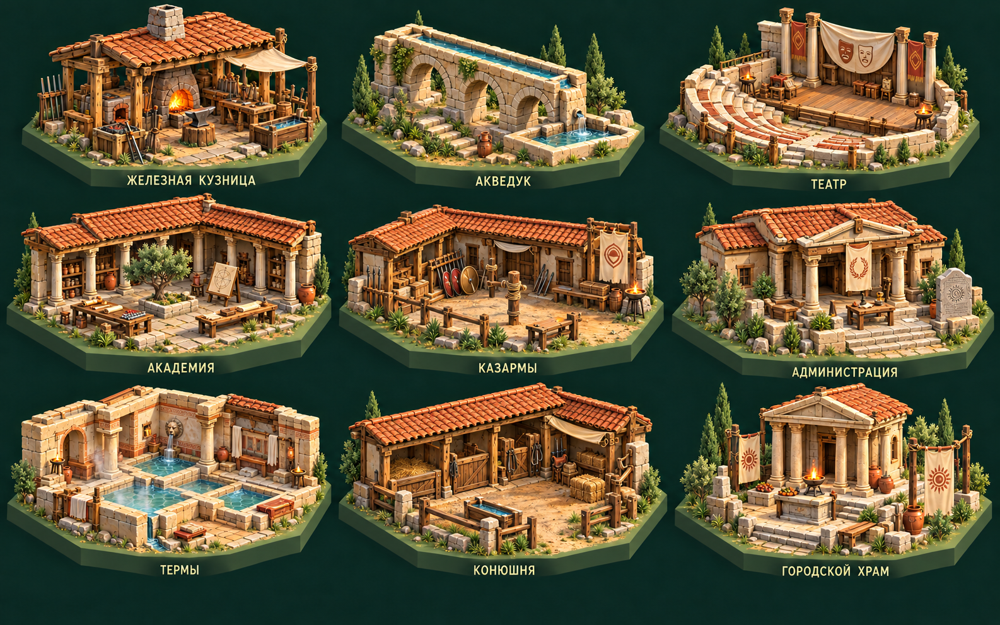
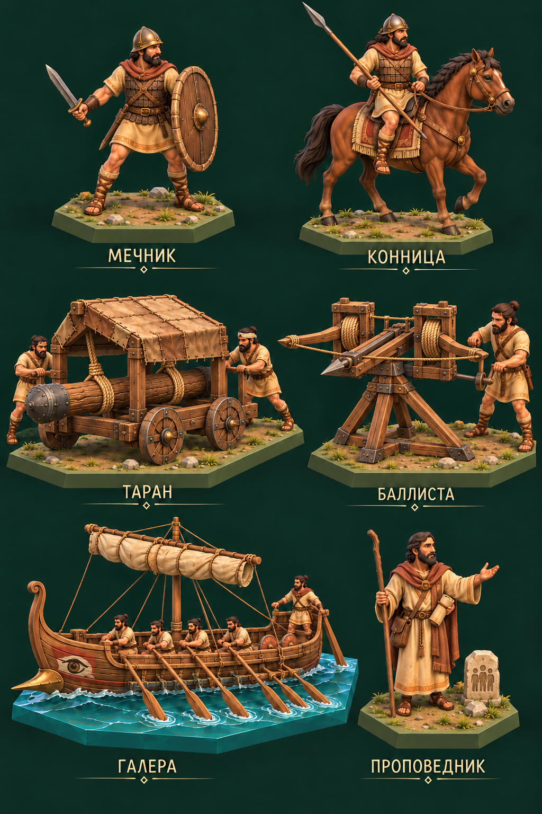
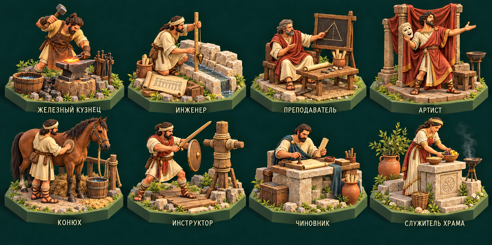
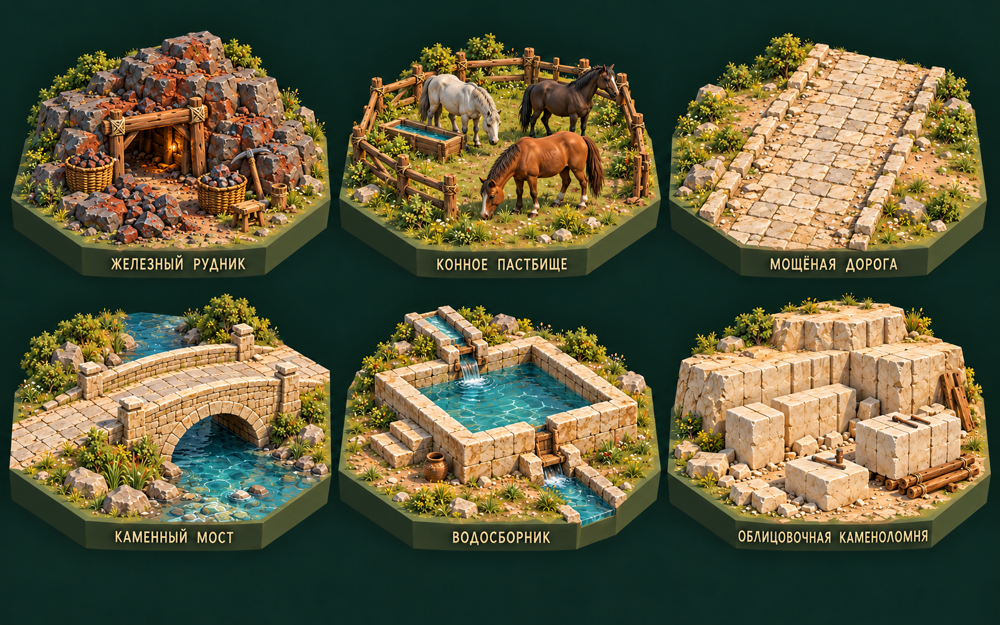
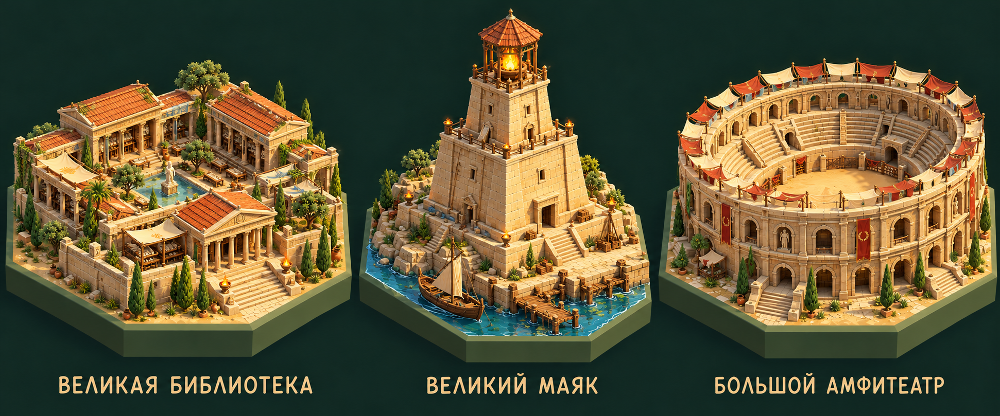

# E04 — художнику: античность и организованные державы

11 октября 2026 года · версия 1.0 · **рисунки для будущих 3D-моделей**, не готовые meshes, скелеты или клипы.

Основа: [OpenSpec художника](../openspec-model-artist-ru.md), [контент E04](../../era-04-antiquity-content-ru.md), [стиль E03](../E03/README.md). Художник создаёт и улучшает модели, риги, веса и свои анимации; предоставленные заказчиком клипы адаптирует и исправляет, сохраняя оригиналы. Игровой код, импорт, prefabs, Animator и интеграция в Unity — задача основного чата.

## 1. Стиль и состав

Продолжить изометрию, тёплый свет, спокойную палитру и подробную объёмную графику E02/E03. Добавить обработанный известняк, штукатурку, деревянные балки, глиняную черепицу, бронзовые и матовые серые железные инструменты. Ткань охристая/льняная с небольшими перекрашиваемыми знаками племени. Камень разнообразный, поверхности не идеально одинаковые. Сохранять приятные лица и естественные руки.

Античные формы: невысокие каменные дворы, ясные колонны/галереи, полукруг театра, арочные инженерные пролёты, мощёные пути. Все державы не обязаны иметь римские гербы: общие функции и отдельные будущие национальные варианты. Не вводить рыцарские доспехи, зубчатые средневековые башни, порох, печатные книги и современную технику.

Ортографическая камера около 35,264°/45°. Все гексы и объекты целиком в кадре; силуэт читается с карты. Проект не требует копировать чужие игровые модели или историческую реконструкцию одного города.

| Итоговый лист | Сетка / содержание |
| --- | --- |
| [Постройки](e04-buildings-v1.png) | 3×3, девять объектов |
| [Юниты](e04-units-v2.png) | 3 ряда × 2 столбца, шесть объектов |
| [Жители](e04-residents-v1.png) | 2×4, восемь профессий |
| [Улучшения](e04-tiles-v1.png) | 2×3, шесть модулей |
| [Чудеса](e04-wonders-v1.png) | Три самостоятельных гекса слева направо |

[Реестр](asset-list.json) содержит **32 ID**, позиции считаются строка/столбец с единицы сверху слева. [Промпты](prompts.json) сохраняют исходные запросы встроенного `image_gen.imagegen`. Случайные отличия рисунка не отменяют требования документа: назвать их до изготовления модели.

Итоговый лист юнитов — **v2**: уточнены два оператора и подвес тарана, один центральный болт баллисты. v1 оставлен как промежуточный вариант. Расположение тетивы, шарниров и точек хвата художник проверяет на настоящей 3D-конструкции; рисунок не является механическим чертежом.

## 2. Здания: форма, конструкция, точки

| ID / позиция | Концепт | Отдельные части / точки |
| --- | --- | --- |
| `iron_forge` / 1,1 | Каменная низкая печь и открытый рабочий навес, ручные мехи, железная заготовка, рабочая наковальня, инструменты и ёмкость охлаждения | Печь, мехи, инструменты, заготовки, вода; `HeatPoint`, `WorkPoint`, `CoolPoint` |
| `aqueduct` / 1,2 | Короткий арочный каменный водовод, открытый верхний канал, городской бассейн и ступени обслуживания; вода имеет источник у края | Опоры/пролёты, верхний канал, бассейн, вода отдельно; модуль входа/выхода и `InspectionPoint` |
| `theatre` / 1,3 | Небольшие полукруглые каменные ступени, открытая сцена, низкое декоративное заднее здание, маски и занавесь | Ступени, сцена, декор, маски; `StagePoint`, `AudiencePoint`; без овальной арены |
| `academy` / 2,1 | Учебный двор, галерея с простыми колоннами, стол, счётные камни, чертёжная доска, свитки/таблички | Крыша/галерея, стол, доска, записи; `TeachingPoint`, места сидения; не средневековый университет |
| `barracks` / 2,2 | Невысокие жилые секции, тренировочный двор, стойки щитов/оружия, манекен и скамья | Двери, крыши, стойки, манекен; `TrainingPoint`, `Entrance`; не замок |
| `administration` / 2,3 | Каменный общественный дом с портиком, широкий вход, двор, стол чиновника и стела | Крыша, стол, стела, лавки; `MeetingPoint`, `WorkPoint`; скромный знак племени |
| `public_baths` / 3,1 | Тёплый каменный корпус с открытым участком бассейнов, раздевальная скамья, каналы и небольшой источник пара | Снимаемая крыша, бассейны, вода, скамьи; `WaterIntake`, `RestPoint`; пар — отдельный эффект |
| `stables` / 3,2 | Низкие стойла с черепичной/деревянной крышей, навес, ограда, поилка, корм и подвешенная упряжь | Стойла, двери, поилка, упряжь; `HorsePoint`, `GroomPoint`. Лошади отдельно |
| `urban_temple` / 3,3 | Каменный храм на невысоком основании, простой портик, открытый двор, чаши и нейтральные знаки общины | Крыша, колонны, алтарь/чаши; `RitualPoint`, `GatheringPoint`; без обязательного символа конкретной современной религии |

По одному обычному зданию на гекс. Двор и вход доступны персонажам. У акведука показывать один короткий узел: огромная арка не закрывает все соседние клетки. Фасады можно улучшать, сохраняя функции и преемственность, не делая каждое здание одинаковым храмом.

## 3. Юниты: внешний вид и анимации

| ID / позиция | Модель и реквизит | Риги и собственные клипы |
| --- | --- | --- |
| `swordsman` / 1,1 | Мечник в льняной одежде, лёгкой кожаной/ламеллярной защите и простом шлеме; матовый железный меч, деревянный щит с кромкой | Общий Humanoid; ожидание, ходьба, рубящий удар, блок, получение удара, падение. Меч/щит отдельно на сокетах |
| `cavalry` / 1,2 | Конь естественных пропорций и всадник с копьём, простая мягкая седельная подкладка и узда; без лат и стремян в базовом концепте | Generic коня + Humanoid всадника; стойка, шаг, рысь/галоп, поворот, атака, реакция, падение; `RiderSeat`, поводья, оружейный сокет |
| `siege_ram` / 2,1 | Невысокая четырёхколёсная деревянная рама, защитная кожаная крыша, бревно на канатных подвесах и два оператора | Generic колёс/подвеса + люди; катить, остановить, отвести бревно, ударить, восстановить, поломка. Бревно не встроено в статичную раму |
| `ballista` / 2,2 | Двуплечий деревянный торсионный механизм, видимые скрутки канатов, ложе тяжёлого болта, ворот и небольшой расчёт | Generic плеч/тетивы/ворота + люди; ожидание, перемещение, натяжение, зарядка, спуск, реакция/поломка. Болт отдельный объект |
| `galley` / 3,1 | Вытянутый дощатый корпус, один понятный ряд вёсел с каждого борта, кормовой рулевой, низкая мачта с простым свёрнутым парусом и небольшой носовой таран | Корпус, вёсла, рулевое весло, мачта/парус отдельно; гребля, остановка, поворот, боевой манёвр/повреждение. Экипаж отдельный |
| `preacher` / 3,2 | Мирный человек с плащом, посохом, небольшим знаком общины и свитком/табличкой; без сияния и оружия | Humanoid; ожидание, ходьба, обращение к слушателям, жест/ритуал, отдых. Никаких лучей магии или обязательной боевой атаки |

Не считать два оператора тарана двумя экономическими жителями, которых следует повторно списать. Галера показывает понятный гребной механизм, не обязана иметь сотню отдельных персонажей. Вол E03 и конь E04 — разные животные, не растянутые варианты одного рига.

Для конницы проверить контакт таза с посадочным местом, хват поводьев, движение ног и отсутствие проваливания всадника в шею. Ход коня и качание человека согласованы. Для тарана подвес качается вокруг реальных опор; у баллисты плечи и тетива движутся вместе, выстрел не возникает из неподвижного меша. Игровую траекторию болта/урон рассчитывает основной чат.

## 4. Жители и рабочие циклы

| ID / позиция | Внешность и действие | Контакт и реквизит |
| --- | --- | --- |
| `iron_smith` / 1,1 | Кузнец с передником: нагреть, ударить по заготовке, охладить | Молоток, держатель/клещи, заготовка, наковальня, ёмкость отдельно |
| `civil_engineer` / 1,2 | Инженер проверяет уровень воды и шов кладки, работает у чертежа | Отвес, мерная рейка, доска/свиток; приборы ручные, без современной рулетки |
| `tutor` / 1,3 | Преподаватель у небольшой доски/стола, показывает геометрическую задачу | Доска, указатель, счётные камни и свиток; без печатного учебника |
| `performer` / 1,4 | Артист на сцене, выразительная поза, отдельная маска и ткань | Маска/реквизит сменные, руки и лицо не закрыты навсегда |
| `stable_keeper` / 2,1 | Конюх чистит коня и проверяет узду | Щётка, ведро/корм, узда; конь самостоятельный, контакт без пересечений |
| `drill_master` / 2,2 | Инструктор демонстрирует стойку у деревянного тренировочного манекена | Учебное деревянное оружие, щит, манекен; не бесконечный боевой спавн |
| `civic_official` / 2,3 | Чиновник у стола читает запись, ставит печать и принимает посетителя | Свиток/табличка, печать, стол; административный, не современный деловой костюм |
| `temple_priest` / 2,4 | Служитель располагает чаши, ухаживает за алтарём, обращается к общине | Чаши, ткань, нейтральный знак; без магических эффектов |

Люди совместимы с утверждённым базовым скелетом E02/E03; лица, возраст, пол, волосы и одежда разнообразны. Сделать общие Idle/Walk/Rest и специфичные Work-циклы. Исправлять клипы заказчика можно и нужно, с отдельными оригиналами и описанием изменений. Игровое время не определяется длиной рабочего цикла.

## 5. Улучшения и инженерные модули

| ID / позиция | Вид | Требование при 3D-моделировании |
| --- | --- | --- |
| `iron_mine` / 1,1 | Тёмные уступы с бурой железной жилой, подпорки, ручная кирка, корзины | Порода, подпорки и реквизит отдельно; никакого промышленного рельсового пути |
| `horse_pasture` / 1,2 | Открытое ограждённое пастбище, поилка, две–три лошади разных мастей | Несколько внешних вариантов одного проверенного конного рига; не сливать животных с землёй |
| `paved_road` / 1,3 | Сухие каменные плиты на земле, аккуратные края, редкая трава | Прямая, повороты 60°/120°, развилка и конец; одинаковые соединения по рёбрам гекса |
| `stone_bridge` / 2,1 | Невысокий каменный пролёт, настил и парапет над естественной рекой | Совместимые выходы дороги и опоры; вода проходит под мостом, русло не меняется |
| `water_reservoir` / 2,2 | Невысокая цистерна/открытый бассейн, узкий входной канал и слив | Вход/выход, бассейн, вода отдельные; источник у края, не новый мировой водоём |
| `dressed_stone_quarry` / 2,3 | Чистые светлые облицовочные блоки, несколько уступов, клинья и санки | Вариант имеющегося камня, не обязательная новая категория мрамора |

На листе дороги один образец, полный набор соединений художник делает отдельно. Трава и мелкие камни редкие, главные инженерные детали читаются. Торговец оставляет сухую дорогу; мост и водовод используют уже существующую реку.

## 6. Чудеса: отдельные силуэты

| ID / положение | Образ | Части |
| --- | --- | --- |
| `great_library` / слева | Крупный, но помещающийся на один гекс библиотечный двор с каменными галереями, центральным учебным местом, хранилищами свитков/табличек | Крыши, галереи, столы, ячейки, записи отдельно. Не копировать обычную академию увеличением масштаба |
| `great_lighthouse` / по центру | Высокая ступенчатая каменная башня на берегу, широкое основание, галерея и верхний огонь под открытым навесом | Башня, обслуживающая лестница/дверь, огонь/дым отдельно; силуэт устойчивый, не тонкая современная труба |
| `grand_amphitheatre` / справа | Замкнутый овальный амфитеатр, два–три читаемых яруса, входные арки, ступени и песчаная арена | Ярусы, проходы и арена отдельно; зрители отдельные. Обычный театр остаётся небольшим полукругом |

Это **три новых предложения**, не уже существующие или согласованные мировые чудеса. Их условия/бонусы описаны в контенте E04; художник не меняет их по величине рисунка. Пирамиды, сады и роща сохраняются в общей библиотеке.

## 7. Экспорт, просмотр и контроль

Исходник `.blend`/формат инструмента, `.fbx`, текстуры, отдельные клипы, реальные рендеры и просмотр движений, `README` с ID, единицами/размерами, типом рига, bind pose, сокетами, LOD и проверками. Люди после экспорта: Y вверх, +Z вперёд, масштаб 1, корень на земле. Для техники указать оси колёс/плеч и точки экипажа. Сохранять точные ID; версии обозначать в имени файла.

Риги с весами обязательны для людей/животных, Generic-иерархия — для механизмов. Проверить шаг, повороты, сгибание суставов, хват, посадку, циклы и синхронный механизм. Root motion игровых перемещений выключен; основные перемещения, снаряды и результаты задаёт игра. В технических позах части не проваливаются друг в друга.

Для браузера — красивые подробные исходники плюс облегчённые LOD; число материалов/отрисовок указано, мелкий декор не размножается тысячами. Вода, пар, пыль и огонь дешевле геометрического покадрового пересоздания.

Для image-to-3D подготовить один вырезанный объект с нейтральным фоном и отдельными согласованными видами; не подавать целый лист. Лошадь, всадник, экипаж, оружие и груз отдельные. Генерация картинки в меш сама по себе не подтверждает хороший риг/анимации.

Первый предложенный образец — `swordsman` на утверждённой базе человека, затем `cavalry` для проверки конного рига и `aqueduct` для архитектуры. При необходимости сначала согласовать качество базы E03, не объявлять старый прототип окончательно принятым.

## 8. Стартовый промпт

> Ты художник, 3D-моделлер и аниматор нашей Unity-стратегии «Истоки». Прочитай общий OpenSpec художника и E04 «Античность и организованные державы». Используй пять листов и реестр 32 моделей. Создавай красивые подробные настоящие 3D-модели, полноценные скелеты, веса и свои анимации; мои клипы при необходимости исправляй, сохраняя оригиналы и показывая правки. В код игры не вмешивайся. Передавай исходники, FBX, текстуры, отдельные клипы и описание для интеграции основным чатом. Сохраняй изометрию и стиль E03, добавляя античную кладку, инженерные сооружения и железный инструмент; без рыцарей, пороха и современных предметов. Начни с одного мечника, затем после моей оценки перейдём к коннице и архитектуре. Если доступны только рисунки, явно отделяй концепты/ключевые позы от реальных моделей и клипов.
