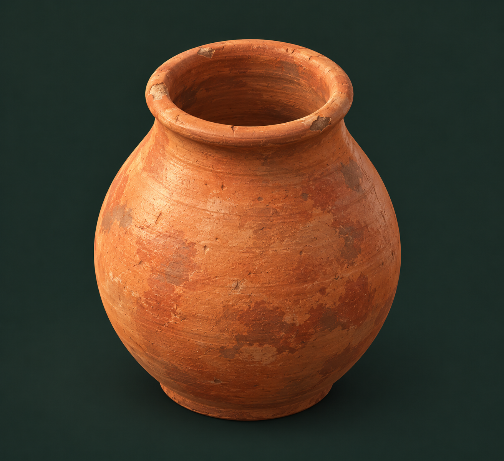

# Первая серия отдельных моделей для локального художника

11 октября 2026 года · версия 1.0 · выбор основного чата по поручению заказчика. Художественное качество каждого результата оценивается заказчиком по одному образцу.

Основа: [общий OpenSpec художника](../openspec-model-artist-ru.md), [обсуждение графики и реальные ограничения программы](../visual-direction-discussion-ru.md), [эскизы ранних построек](../E02/e02-buildings-v1.png). Программа художника локальная; здесь готовятся концепты, порядок и задания, а не игровой код.

## Выбранная очередь

| Очередь / предварительное имя ассета | Модель | Что проверяет / где пригодится |
| --- | --- | --- |
| 1 · `clay_pot_a` | Глиняный горшок без ручек | Округлая форма, полость, толщина и матовая глина; дома, гончарная, амбары, торговля |
| 2 · `log_a` | Одно лежащее бревно | Неровное дерево, торцы, мягкие края; строительство, плотницкая, лесная делянка |
| 3 · `fence_section_a` | Секция деревянной ограды | Соединения, верёвка, модульность; пастбище, поля и рабочие площадки |
| 4 · `thatch_panel_a` | Секция соломенной крыши | Толстый край, группы соломы, архитектурная поверхность; дома и навесы |
| 5 · `wicker_basket_a` | Открытая плетёная корзина | Объёмное плетение и аккуратность повторов; поля, глина, мастерские, торговля |

Это художественные имена, а не новые экономические ID. Каждая позиция — самостоятельный предмет с редактируемыми частями; выпускать сразу всю серию не требуется.

Почему порядок изменён после предложения начать с колосьев: художник проверил местный инструмент и сообщил, что основное растение исключается как декор, а подходящих конструкторов листьев и колоса ещё нет. Основы полого сосуда, бревна, балок/перевязок и соломенных панелей существуют; их качество проверяется отдельно. Для горшка требуется настраиваемый профиль, чтобы выдержать заданное отверстие и стенку. Пшеница остаётся целью следующего этапа после расширения растительных форм.

По уточнению художника имеющееся плетение — плоская панель XZ, а не готовый конструктор корзины. Для корзины нужны изогнутые стенки, плетёное дно и усиленный край. Поэтому соломенная панель перенесена на четвёртое место, корзина — на пятое, после развития объёмного плетения. Наличие категории формы не означает готовность конкретной модели.

## Первый предмет — горшок

Рисунок создан встроенным `image_gen.imagegen`; точный запрос сохранён в [prompts.json](prompts.json). Это концепт, настоящую 3D-модель создаёт и проверяет локальный художник.

Используйте [отдельное задание первой модели](01-clay-pot-ru.md). Примерный размер: высота 0,45 м, диаметр корпуса 0,32 м, отверстия 0,18 м, стенка около 0,015 м. Точные размеры определяет задание; перспективное восприятие рисунка не является измерением. Мягкий цельный контур, короткое горло, толстый округлый край, широкое устойчивое основание. Сосуд пустой, внутренность действительно полая, естественная неоднородность терракоты и очень умеренные следы изготовления.

## Краткие задания следующих позиций

**Бревно:** длина около 0,9 м, диаметр 0,14–0,18 м, слегка неровная форма, кора и два различимых среза. Без веток, земли, пилы и стопки других брёвен. Крупные формы коры читаются на расстоянии, тонкие волокна — вблизи. Один предмет пригоден для отдельного переноса строителем.

**Ограда:** ширина секции около 1,6 м, высота около 0,8 м, две стойки и две горизонтальные жерди, аккуратные верёвочные соединения. Дерево и верёвка остаются отдельными редактируемыми частями. Без металла, ворот, земли и животных. Края позволяют соединить повторяющиеся секции без перекрывающихся двойных столбов; выбранный способ соединения указать в README.

**Корзина:** открытая пустая корзина высотой около 0,35 м и диаметром около 0,35 м, плетёное дно и стенки с видимой толщиной, усиленная кромка. Без зерна, глины, крышки и подставки. Немного различающиеся ленты плетения, без одинаковых острых выступов и ряби; наполнение в будущем отдельный реквизит.

**Соломенная панель:** примерно 1×1 м с толщиной края 0,12–0,18 м; видимые группы соломы, лёгкая неровность края, направленные вниз волокна, перевязка у верхней части. Без целого дома, гекса и опорных столбов. Отдельный строительный модуль с понятным положением на стропилах, верх/низ и направление укладки описаны в README. Числа уточняются по визуальной оценке.

Референсы для следующих позиций подготавливаются отдельно к их очереди. Цель — оценить один качественный результат и перенести принятые решения дальше.

## Общая передача и проверка

- Один предмет на референсе, минимум фона; свет и тень картинки не включать в геометрию.
- Единицы — метры, основание на нуле; Blender Z вверх, Unity после экспорта Y вверх. Оси/масштаб документировать.
- Красивый подробный исходник, FBX, текстуры, LOD1/LOD2, настоящие рендеры, отчёт о проверке FBX обратным импортом. Для этих статических предметов скелет не нужен.
- Реальный крупный рендер, вид с игровой камеры, оборот при постоянном свете и сравнение LOD. Материалы оцениваются в Blender; нынешний интерактивный просмотрщик показывает геометрию и базовые цвета.
- Версии сохраняются отдельно; текущие игровые модели и пользовательские анимации не заменять.
- Если результат не соответствует референсу, указать причину: описание, построение формы, материал или экспорт. Техническое наличие файла не означает принятый художественный результат.

Игровые цены и бонусы не изменяются. Массовая генерация клеток, анимации стройки и тренировок остаются отдельными последующими задачами.
