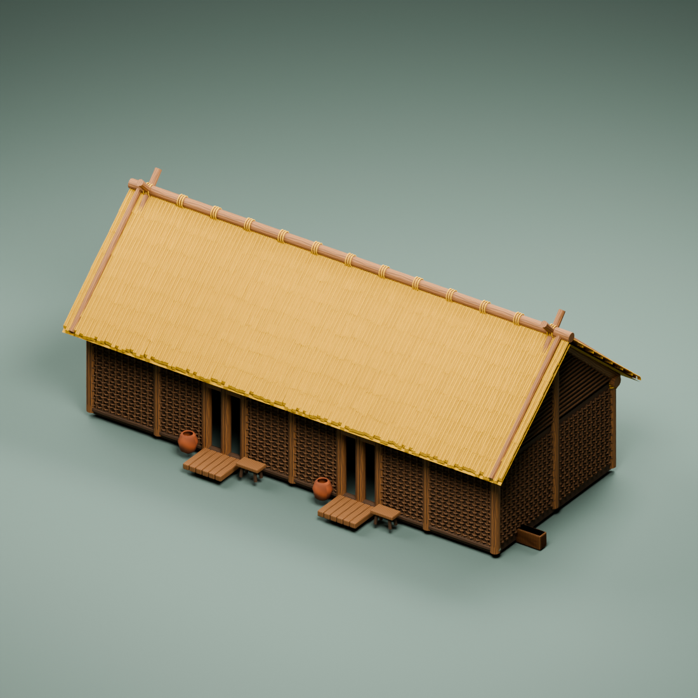
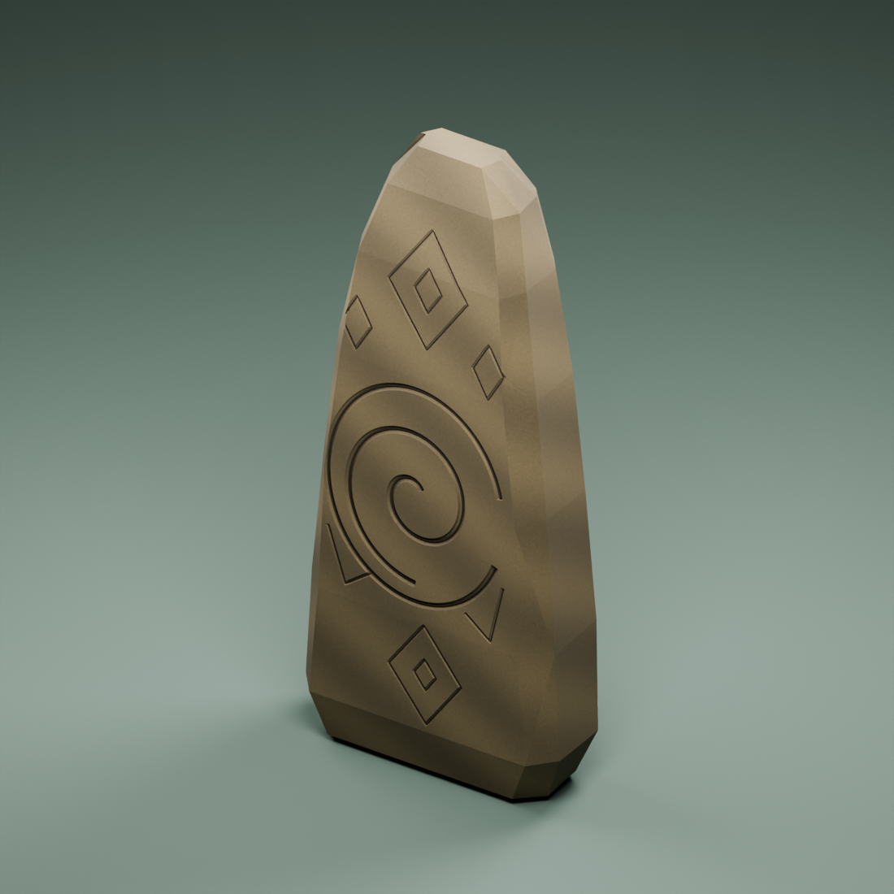

# Графика «Истоков»: обсуждение концепта с художником

11 октября 2026 года · версия 0.3 · **предложение после обсуждения с художником; качество графики ещё не утверждено заказчиком**.

Заказчик поручил основному чату продумывать концепт по своему сценарию и общаться с художником. Художник делает реальные модели, материалы, скелеты и движения, по одному образцу. Основной чат определяет назначение, художественные требования и приёмку. Подключение в Unity и массовое изготовление сейчас отложены для проработки графики.

Уточнение заказчика: «художник локально прогу делает». Чат художника разрабатывает локальную программу Drawer3d для создания и просмотра моделей; концепты основного чата служат заданиями и образцами качества для результата. Обсуждение графики не отменяет текущую работу над инструментом. Возможности генерации подтверждаются отдельно на настоящем сохранённом образце.

Основа: [общий OpenSpec художника](openspec-model-artist-ru.md), [эскизы E02](E02/README.md), особенно [лист улучшений](E02/e02-tiles-v1.png). Исходные правила игры сохраняются; этот документ описывает внешний вид, а не новые экономические эффекты.

## 1. Художественное направление

Подробная стилизованная объёмная графика. Тёплый мягкий ключевой свет сверху слева, спокойные естественные цвета, ясные тени между частями. Предмет должен сохранять узнаваемость на карте и иметь интересную конструкцию при приближении.

Три уровня формы:

1. С расстояния карты — общий силуэт, основной цвет, назначение.
2. При среднем приближении — соединения, группы соломы, плетение, характер колосьев, крупные сколы.
3. В крупном плане — зерно, волокна, резьба, складки, мелкие следы работы.

Стилизация усиливает характерные формы. Маленькая неровность должна иметь причину: солома лежит пучками, дерево слегка изгибается, камень имеет отдельные сколы. Одинаковая случайная деформация всех поверхностей создаёт шум. Количество полигонов определяется формой и проверкой расстояния; детализация сама по себе не гарантирует художественное качество.

Материалы различимы: матовая солома, дерево с мягким блеском на обработанных местах, грубое плетение, неглазурованная глина, камень с широкими вариациями цвета. Свет и тени проверяются на настоящем 3D-рендере, чтобы приятный вид сохранялся при вращении.

## 2. Первый предложенный одиночный образец

**Пучок зрелых колосьев** из верхнего левого поля на листе E02. Предварительное художественное имя `grain_clump_v01`, не новый игровой ID.

- Примерно 7–12 стеблей; окончательное количество художник выбирает по силуэту.
- Два–три уровня высоты, несколько наклонённых колосьев, длинные изогнутые листья.
- Колос немного усилен по толщине, чтобы растение читалось с игровой камеры.
- Золотистые вершины, охристые стебли и более тёмные основания; немного зелени у нижних листьев.
- Зёрна показывают объём в крупном виде; повторяющиеся мелкие грани и жёсткие одинаковые блики не забивают общий контур.
- Только растение, основание на земле, без гекса, почвы, ограды и корзин в одном меше.
- Предлагаемый ориентир высоты 0,55–0,9 м, проверяется рядом с человеком; это художественный масштаб для первого образца, не окончательный биологический стандарт.

Пучок покажет качество растений и материалов. После оценки — несколько вариантов того же растения, затем сноп, корзина и секция ограды отдельными моделями. Положение, поворот и количество выбираются при сборке клетки. Кусты и трава общего декора остаются редкими по последнему требованию заказчика; само зерновое поле имеет собственный узнаваемый рисунок посадок.

Лёгкое покачивание — предложение визуального эффекта: основания неподвижны, верхушки отклоняются мягко и с разной фазой. Для художника достаточно подготовить пригодную геометрию и при необходимости маску вершины; механизм ветра подключается основным чатом позднее. У растений человеческий скелет не требуется.

По обсуждению с художником первый образец делаем **статическим**: сначала оценка формы. Следующий предложенный образец после оценки пшеницы — отдельная секция соломенной крыши, чтобы проверить архитектурный материал и характер края до изготовления целого дома.

## 3. Проверка одного образца

Одинаковые камера и освещение для сравнений: ортографическая изометрия около 35,264°/45°, нейтральное окружение, мягкий ключевой свет. Для просмотра можно вращать предмет, сохраняя изометрическую камеру.

Художник показывает:

- Крупный вид: форма колоса, листья, материал, аккуратность соединений.
- Вид с игрового расстояния: узнаваемость, цвет, отсутствие ряби.
- Полный оборот в одинаковом освещении и несколько отдельных ракурсов.
- Предмет рядом с масштабной фигурой, только в диагностическом кадре.
- Сравнение подробного варианта и облегчённого LOD.

Передача: редактируемый исходник, FBX, текстуры, варианты LOD, реальные рендеры и описание масштаба/оси/основания. Изображение эскиза служит ориентиром; наличие настоящих файлов и качество 3D проверяются отдельно. Жёсткий бюджет треугольников до первого просмотра не фиксируется: сначала определяется нужный силуэт, затем измеряется цена повторения на карте.

## 4. Клетка собирается из библиотеки

Зерновое поле: почва с посадками, варианты пучка, сноп, корзина, ограда. Орошаемое поле использует ту же пшеницу и дополняет её отдельными каналами, переходами и модулем воды. Природная река существует до улучшения.

Пастбище: ограда/ворота, поилка, кормушка и животные отдельными объектами. Для животных нужны настоящие риги, веса и собственные циклы движения. Глиняная выработка: углубление и уступы, куски глины, корзины, деревянный инструмент. Лесная делянка: деревья, брёвна, пень, рабочая опора и каменный/деревянный инструмент соответствующей эпохи.

У моделей есть самостоятельное назначение и возможность менять расстановку. Гекс-подставка в эскизе не обязывает запекать весь набор в единый неподвижный объект. Декоративные животные и жители не увеличивают экономический доход.

## 5. Архитектура: текущий образец и развитие

Посмотрен настоящий рендер `C:/AI/Drawer3d/models/longhouse-detail-test/preview/iso.png`. В нём хорошо показаны деревянная конструкция, плетёные стены и солома. Для обсуждения предложены:

- Более толстый край крыши, заметные группы соломы, небольшая волна конька.
- Несколько различающихся секций плетения и неодинаковые балки.
- Более мягкие кромки и ясная тень под свесом.
- Разная роль крупных конструкций и мелких волокон; крыша сохраняет объём на расстоянии.

Посмотрен новый авторский камень памяти `Builds/ArtistHandoff/Origins-MemorialStone-Artist-v01/preview/iso.png`: понятная вертикальная форма и резьба. Предложение к общему стилю — крупный выразительный контур, основной читаемый знак, затем мелкая поверхность. Эти замечания не означают, что заказчик уже одобрил текущие образцы или поручил массово их переделывать.

## 6. Сценарий видимого строительства

Заказчик хочет несколько ходов строительства с растущим прогрессом и работающими строителями. Для первого дома предлагаются четыре стадии:

| Стадия | Геометрия | Действия |
| --- | --- | --- |
| Площадка | Разметка, опоры, материалы, подготовленное основание | Переносить материалы, готовить основание |
| Каркас | Стойки, поперечные балки, временные рабочие опоры | Поднимать балку, связывать соединение |
| Стены | Часть плетения/заполнения, стропила, доступ к рабочим местам | Собирать стену, крепить стропила |
| Крыша и отделка | Солома, двери, завершённые стены, реквизит | Укладывать солому, завершать вход |

Крупные стадии дополняются небольшой видимой прибавкой между ходами: больше заполненных секций стены или полос крыши. Прогресс берётся из накопленного труда; визуальный цикл не выдаёт дополнительные очки производства. В планировании люди отдыхают или готовятся, в действиях работают, а на завершении виден итог нового состояния.

Здания моделируются отдельными конструктивными частями, с временным реквизитом стройки. Строители — визуальные исполнители заказа, а не новые управляемые рабочие или дополнительные экономические жители. Точные диапазоны процентов, количество людей и способ появления частей ещё обсуждаются.

## 7. Сценарий подготовки отрядов

Для первых военных заказов предлагается площадка возле столицы: новобранцы и инструктор тренируются, с прогрессом получают соответствующее снаряжение. Для производства в других городах место подготовки определяется отдельно. Перед завершением это сценка заказа; после завершения выходит управляемый отряд.

Мирные заказы показывают свою деятельность: поселенцы собирают припасы, торговец готовит груз, проповедник репетирует обращение. Судно собирается у воды, экипаж готовит вёсла. Новобранцы и декорация не расходуют население повторно, не атакуют и не получают экономический доход за анимацию.

Художнику нужны общие человеческие риги, а затем рабочие/тренировочные клипы, отдельные инструменты, снаряжение, манекен и точки контакта. Подробное задание движения формируется для каждого назначенного образца после оценки базового качества.

## 8. Ответ художника и порядок следующих образцов

Художник из чата «Подготовить образец копейщика» прочитал концепт и поддержал иерархию деталей и первый пучок колосьев. Уточнил: число стеблей — ориентир; важнее две–три группы высоты, несколько наклонов, объёмные колосья и немного усиленная ширина листьев. Статическая форма оценивается до покачивания.

По архитектуре поддержаны толстый край и группы соломы, немного различающиеся балки и секции плетения. Для камня важна читаемость главного знака, чтобы мелкая резьба не превращалась в чёрную сетку на расстоянии. Для дома предложены отдельные конструктивные группы и точки контакта строителей; для войск — тренировочный реквизит и общий риг.

Совместно предложенная последовательность: пучок колосьев → оценка заказчика → секция соломенной крыши → оценка → дальнейшие варианты растений/реквизита и модульная архитектура. Массовое изготовление пока не поручено, новые модели по этому обсуждению художник не запускал.

Единицы — метры, основание на нуле. В Blender высота по Z; после экспорта и импорта в Unity высота по Y, направление и масштаб проверяются по общему OpenSpec. Это разные системы координат одной модели, а не разные художественные масштабы.

По отчёту художника локальный `C:/AI/Drawer3d/Drawer3d.exe` получил интерактивный просмотр реальной геометрии: ЛКМ — вращение, колесо — приближение, ПКМ/СКМ — перемещение, двойной щелчок/F/Home — исходный вид. В общей галерее программы есть камень, дом и копейщик; художник сообщает о проверках переключения и просмотра. Основной чат эти проверки самостоятельно не повторял.

Интерактивный просмотр показывает форму и базовые цвета. Подробные материалы и мягкие тени оцениваются по настоящему Blender-рендеру. Такая возможность просмотра отдельно подтверждает работу интерфейса; универсальное создание любых моделей по эскизу требует собственных проверок. Исходники, пользовательские клипы и игровой код по отчёту художника сохранены.

## 9. Подтверждённые художником границы локального процесса

Вход — одна картинка через файл/буфер/перетаскивание и необязательное описание. На картинке из нескольких предметов один предмет выделяется рамкой. Для будущего задания готовится крупный отдельный референс с минимумом фона; в описании размеры, материалы, обязательные детали и исключаемые предметы. Скрытая сторона одного ракурса требует художественной интерпретации.

По проверке художника нынешний автоматический процесс использует локальную `qwen3.5:9b`, изображение уменьшается до 512 px, результат проверяется как JSON и передаётся существующим конструкторам Blender. Набор ограничен: примитивы, балки, камни, брёвна, тела вращения, небольшие произвольные сетки, перевязки, панели соломы, плетение и резьба. Повторение одинаковых деталей предусмотрено; автоматическое разделение всего листа на библиотеку предметов ещё не реализовано.

Красивые текущие дом, копейщик и камень являются авторскими сборками. Они показывают желаемое качество и работу экспорта, но сами по себе не подтверждают такое же качество автоматического пути. На каждом новом типе отдельно проверяются соответствие эскизу, настоящий результат и экспорт.

Для **пучка колосьев** обнаружено ограничение: текущая инструкция исключает растения как фоновый декор, а специальных форм изогнутого листа, стебля и колоса ещё нет. Прежде чем обещать автоматическую пшеницу, художнику потребуется отделить основное растение от окружения, расширить конструкторы органических форм и проверить одну генерацию. Число стеблей можно задать повторениями; выразительная форма колоса остаётся задачей следующего улучшения программы. Это условие технической проверки предложенного первого образца.

Будущее краткое описание для программы: «Один пучок зрелой пшеницы, высота около 0,7 м, несколько стеблей разной высоты, объёмные колосья, изогнутые листья, золотистая палитра; без почвы, подставки, корзины и ограды». Пока это цель разработки и ориентир качества. Секция соломенной крыши использует уже существующую категорию форм и может служить отдельной проверкой текущего процесса.

Ветер, новые анимации, автоматические стадии стройки, тренировочные сценки и раскладка гекса — концепт будущих систем. Наличие локального просмотрщика не означает, что эти функции уже реализованы. Пользовательские правила игры не изменяются.
